# Halvet

Shaxsiy turk hammomi, sauna va basseynlarni kalitgacha quruvchi jamoaning premium sayti: uch tilda (uz/ru/en), 3D sahnalar, muhandislik kesimlari va ilhom galereyasi bilan.

    

**[Sayt](https://halvet.dtwin.uz) · [Jonli demo](https://wonmor.io/demo/halvet/)**

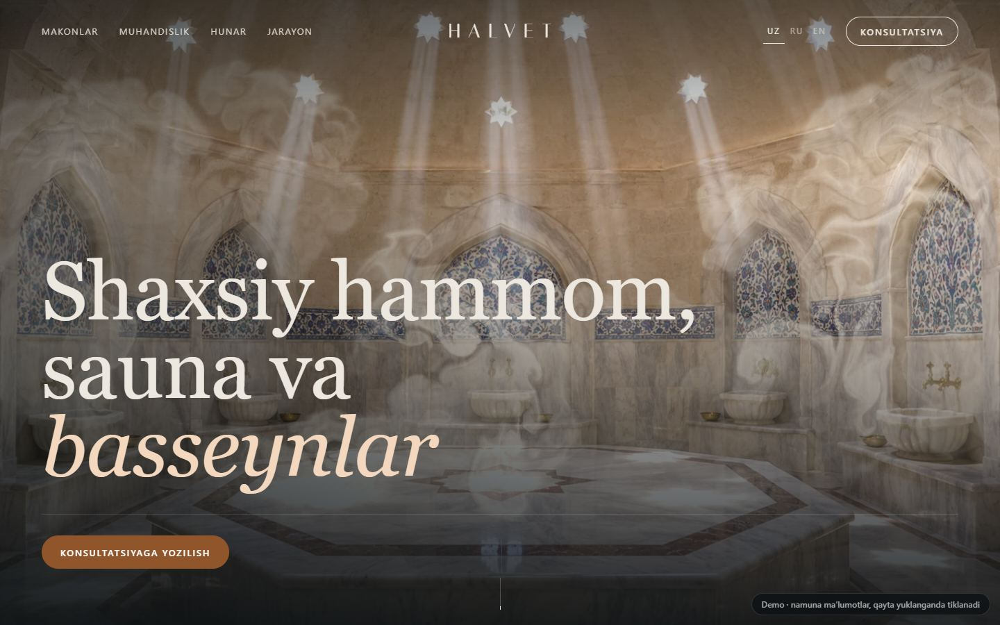

## Nima bor

- **Hero bug'i** — GPU stable-fluids simulyatsiyasi (`v1/vapor.js`): bug' kurnalardan ko'tariladi, sichqoncha uni suradi; zaif qurilmada `fog.js` / `steam.js` zaxirasi.
- **Makonlar** — hammom, sauna, basseyn bo'ylab scroll bilan 3D kamera parvozi (`spaces3d.js`) va "Kayfiyat" video lentasi.
- **Muhandislik** — interaktiv 3D kesim (basseyn / fin saunasi / turk hammomi, 7 nuqtali oqim), 3D texnik xona va 7 ta SVG chizma: filtratsiya, isitish, elektrika, santexnika, bug', suv kimyosi, avtomatika.
- **Aqlli boshqaruv** — konsepsiya paneli va Telegram mini-ilova namunasi (qiymatlar simulyatsiya, "Tez kunda" belgisi bilan).
- **Hunar** — WebGL shisha mozaika (`mosaic.js`) va girih naqshi qurilishi (`girih.js`).
- **Ilhom galereyasi** — 14 litsenziyali surat, 6 filtr, muallifi ko'rsatiladigan lightbox.
- **Taqqoslash, jarayon, FAQ va ariza formasi** — 6 savol, 6 bosqich, makon tanlovli konsultatsiya formasi.
- **Uch til** — `/ru`, `/en` o'zbekcha manbadan `tools/i18n.mjs` bilan yig'iladi (600+ bo'lak); tarjimasiz bo'lak bo'lsa deploy to'xtaydi.

## Skrinshotlar

| | |
|---|---|
| 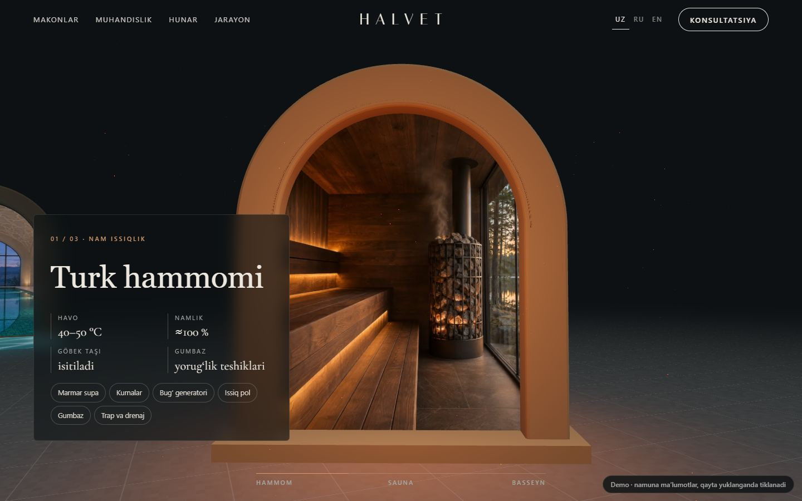 | 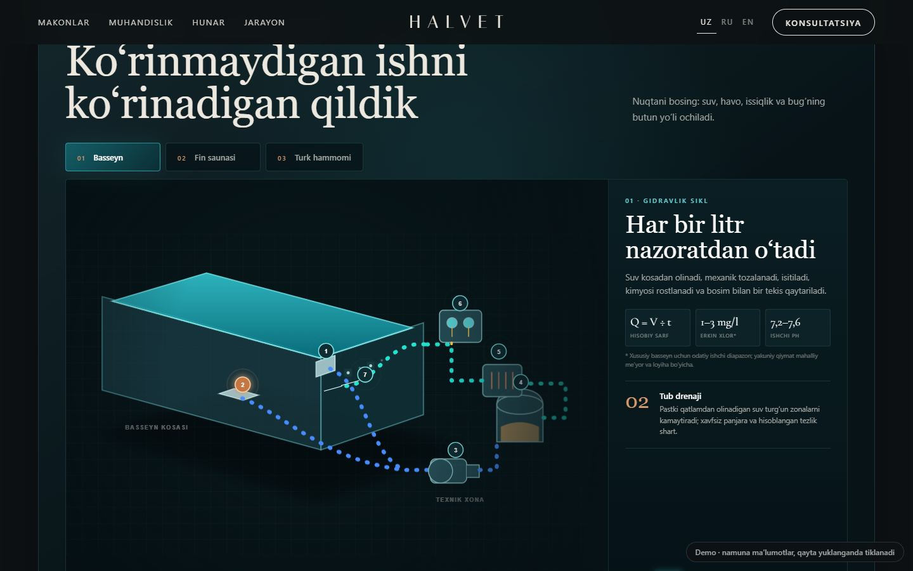 |
| Makonlar: scroll bilan 3D parvoz | Basseyn tizimi: interaktiv 3D kesim |
| 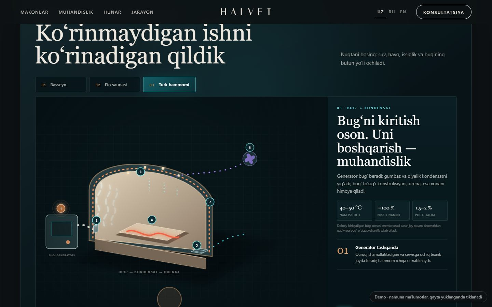 | 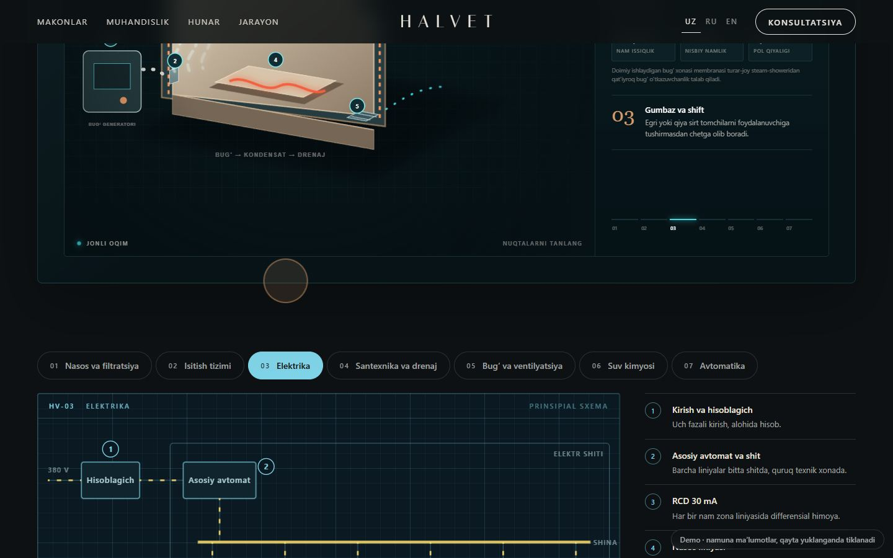 |
| Turk hammomi: bug' → kondensat → drenaj | Chizmalar: HV-03 elektrika |
| 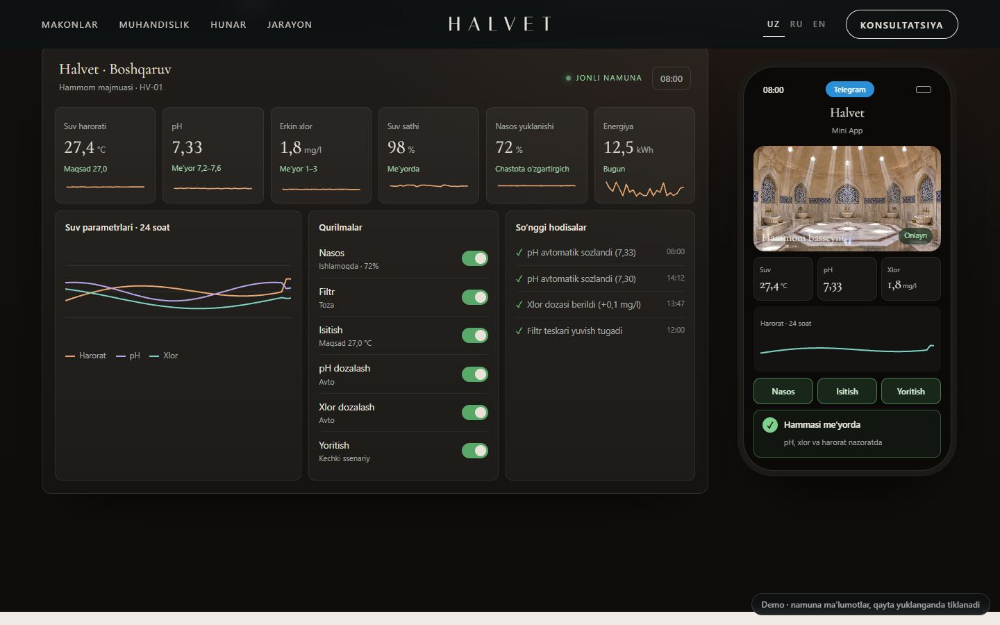 | 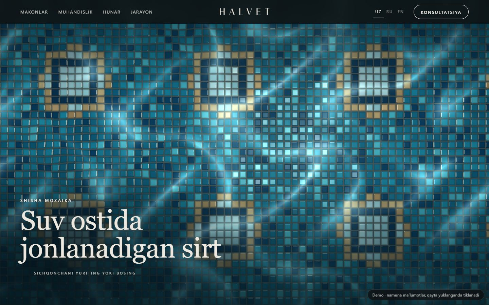 |
| Aqlli boshqaruv konsepsiyasi | WebGL shisha mozaika |
| 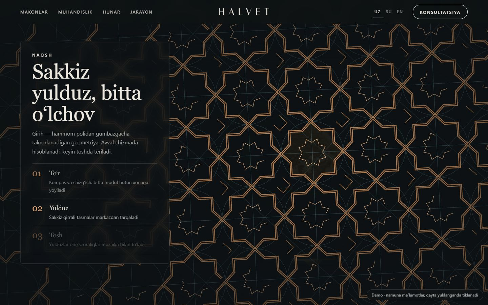 | 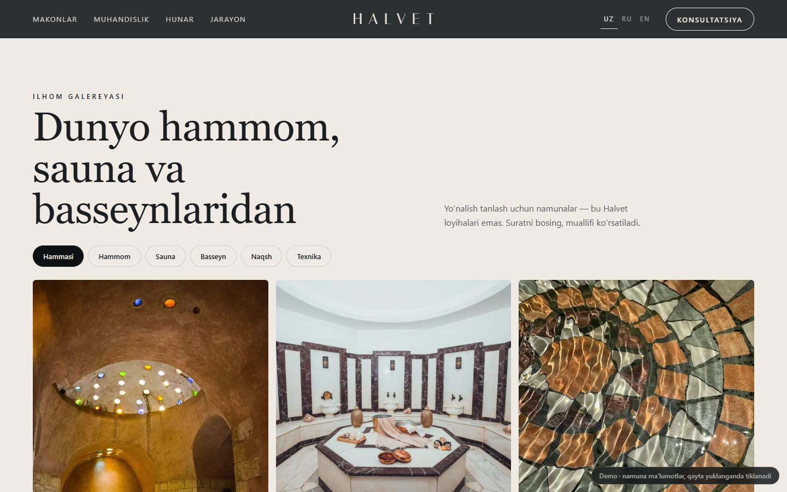 |
| Girih naqshi | Ilhom galereyasi |
| 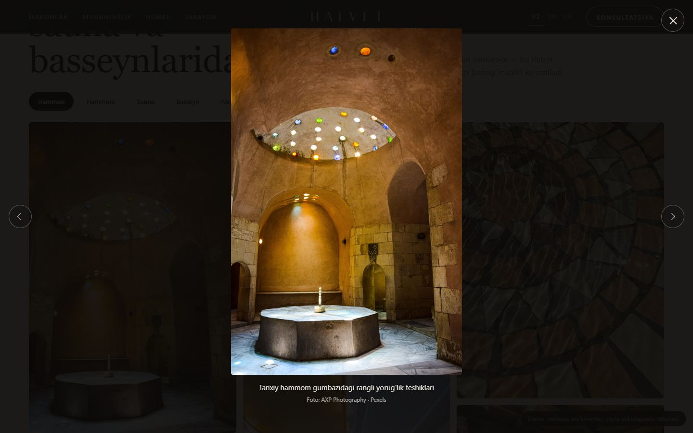 | 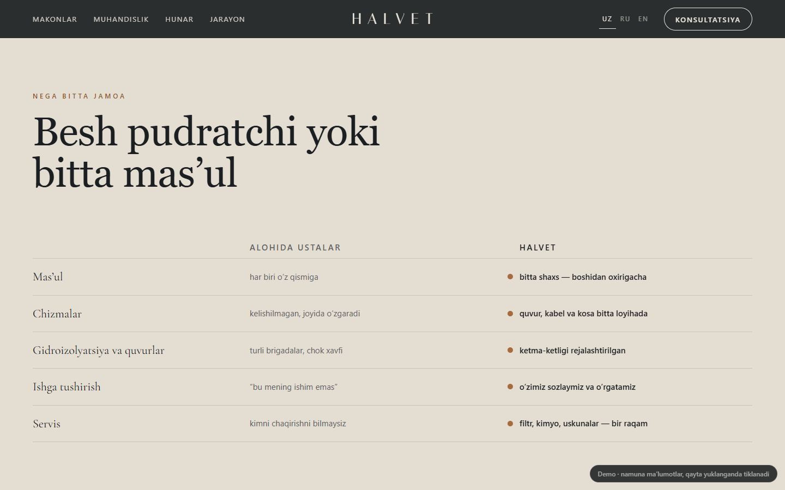 |
| Lightbox va surat muallifi | Taqqoslash |
| 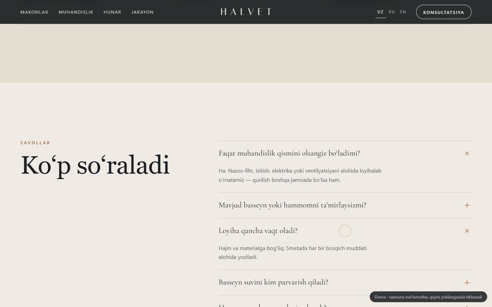 | 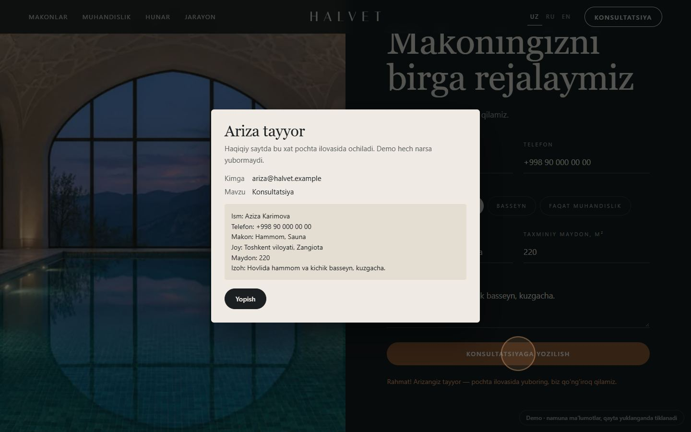 |
| Savollar | Konsultatsiya arizasi (demo xatni ko'rsatadi) |
| 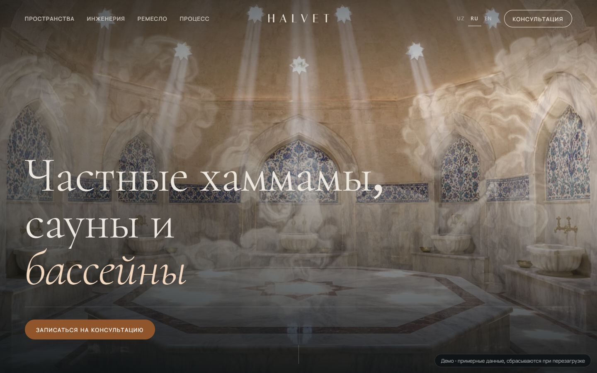 | 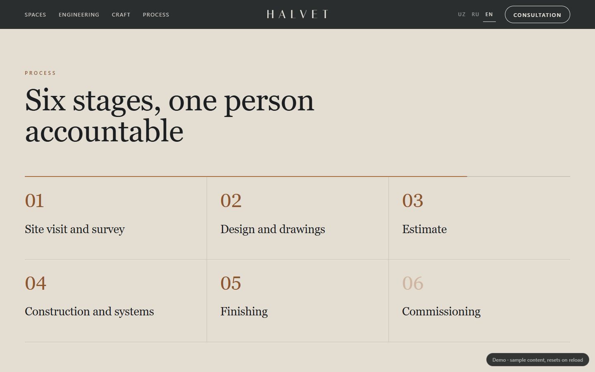 |
| Ruscha | Inglizcha |

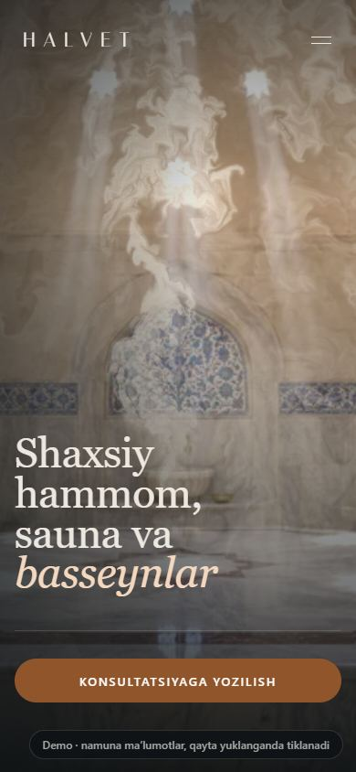

## Tez boshlash

```bash
node tools/i18n.mjs build && python -m http.server -d v1 8080   # http://localhost:8080
```

## Jonli demo

Demo — `v1/` saytining o'zi, `/demo/halvet/` kabi istalgan pastki yo'lda ishlaydigan statik nusxa: til havolalari nisbiy, burchakda "Demo" belgisi, ariza formasi pochta ilovasini ochmasdan yuboriladigan xatni ko'rsatadi. `v1/` va deploy o'zgarmaydi.

```bash
npm ci
npm run build:demo          # dist-demo/
npm run serve:demo          # http://127.0.0.1:4188/demo/halvet/
npm run test:demo           # build + Playwright smoke (uz/ru/en, barcha bo'limlar)
npm run site:screenshots    # docs/screenshots/*.jpg ni yangilash
```

## Tuzilma

| Papka | Nima |
|---|---|
| `v1/` | Sayt: `index.html`, `styles.css`, bo'lim skriptlari, `img/` (WebP srcset), `fonts/`, `media/`, `vendor/` (three, Lenis) |
| `i18n/` | ru/en tarjimalar (`tools/i18n.mjs extract` → `*.missing.json`) |
| `tools/` | i18n, rasm konvertatsiyasi (`images.ps1`), demo yig'ish (`demo-build.mjs`, `demo/`) |
| `deploy/` | Statik konteyner va `deploy.sh` (faqat toza `origin/main`) |
| `e2e/` | Demo smoke testlari |

## Development

```bash
node tools/i18n.mjs extract   # yangi matn qo'shilganda tarjima qilinmagan bo'laklar
node tools/i18n.mjs build     # index.ru.html, index.en.html, *.ru.js, *.en.js
npm run test:demo
```

Videolar: Pexels / Mixkit (litsenziya sayt footerida). Galereya suratlari mualliflari lightbox'da ko'rsatiladi.
